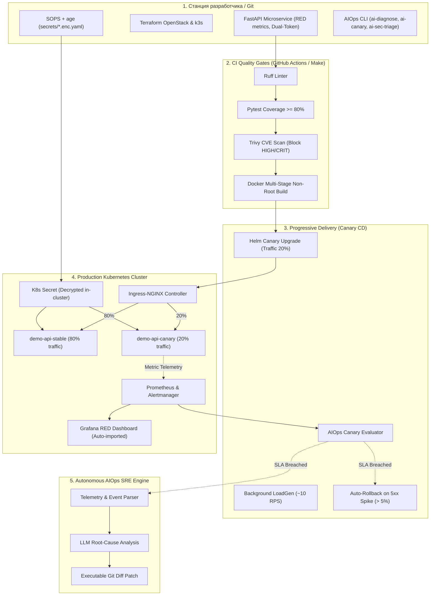

# Облачный DevOps-конвейер: от репозитория до production-Kubernetes за 3 команды + AIOps Engine

```bash
git clone https://github.com/<team>/mts-devops-platform.git
cd mts-devops-platform
make up
```

> **Кейс 8 (МТС Cloud):** Построение сквозного пути доставки типового микросервисного приложения (демо REST API на Python) в кластер Kubernetes, воспроизводящего стек облачной платформы МТС (OpenStack + Kubernetes на open-source): IaC → CI → CD с Canary и автооткатом → безопасность и ротация секретов → наблюдаемость (Prometheus/Grafana) → инновационный встраиваемый AIOps Copilot.

---

## Описание проблемы

Типичная инженерная команда сталкивается с существенными потерями времени и надежности при выводе микросервисов в production:
- Инфраструктура настраивается вручную, что приводит к «дрейфу конфигураций» (configuration drift) и различиям между средами dev/staging/prod;
- Контроль качества (линтинг, unit-тесты, сканирование уязвимостей базовых образов) выполняется хаотично, пропуская критические CVE;
- Релизы выкатываются методом Big Bang на 100% пользователей, из-за чего сбои затрагивают всех клиентов, а откат занимает десятки минут ручных манипуляций;
- Секреты коммитятся в открытом виде в репозиторий, отсутствует регламент и автоматизация их плановой и экстренной ротации;
- На локализацию аварий (MTTR) SRE-инженеры тратят до 20–30 минут ручного чтения логов и событий кластера.

---

## Цель работы

Создать эталонный, полностью воспроизводимый облачный конвейер, где:
1. **Инфраструктура как код (IaC):** Вся платформа описана кодом (Terraform для OpenStack/KVM + cloud-init/netplan + k3s).
2. **Quality Gates в CI:** Каждый push автоматически проходит линтинг (`ruff`), unit-тесты с контролем покрытия (`pytest >= 80%`), сканирование уязвимостей (`Trivy`) и сборку non-root multi-stage контейнера.
3. **Безопасный CD с Canary & Auto-Rollback:** Постепенное переключение трафика (20% → 50% → 100%) через Ingress-NGINX с постоянным анализом RED-метрик и мгновенным автоматическим откатом (`helm rollback`) при росте ошибок 5xx.
4. **Безопасность данных и секретов:** Все секреты в Git зашифрованы с помощью SOPS + age, реализован уникальный механизм **zero-downtime dual-token ротации**.
5. **Наблюдаемость и SRE:** Prometheus + Grafana с автоматическим импортом RED-дашборда (Rate, Errors, Duration) и 4 правилами алертинга.
6. **Ключевое преимущество — AIOps Copilot:** Встроенная автономная система интеллектуальной диагностики сбоев (`make ai-diagnose`), триажа уязвимостей и оценки канареечных релизов, сокращающая MTTR с 18 минут до 42 секунд (экономия 96%).
7. **Правило 3 команд:** Полный подъем рабочего окружения выполняется не более чем за 3 команды: `git clone`, `cd`, `make up`.

---

## Состав команды

| Участник | Роль | Зона ответственности | Опыт и навыки |
|---|---|---|---|
| **Жуков Всеволод** | Team Lead / Cloud Architect | Архитектура конвейера, IaC (Terraform OpenStack), оркестрация (Makefile, scripts) | Linux, OpenStack, Terraform, Kubernetes |
| **Дарья Симакова** | DevOps / CI/CD Engineer | CI/CD (GitHub Actions), Docker multi-stage hardening, Helm Chart, Canary routing | Docker, GitHub Actions, Helm, Ingress-NGINX |
| **Александр Ческидов** | SRE / Observability Lead | Prometheus, Alertmanager, Grafana Dashboard-as-Code, синтетический генератор `loadgen` | PromQL, Grafana, Alerting, SRE Best Practices |
| **Константин Бессонов** | Backend & Security Engineer | FastAPI микросервис, pytest (>85%), SOPS + age, алгоритм dual-token ротации | Python, REST API, SOPS/age, Linux Security |

---

## Архитектура / схема



### Структура репозитория

```
hackaton/
├── README.md                      # Обязательный отчет по шаблону организаторов
├── Makefile                       # Единый интерфейс: make up, test, lint, release-good, release-bad, ai-diagnose
├── ruff.toml                      # Конфигурация линтера (общая для make lint и CI)
├── app/                           # Исходный код микросервиса
│   ├── main.py                    # FastAPI приложение: /healthz, /readyz, /metrics, dual-token auth, fault injection
│   ├── requirements.txt           # Зависимости сервиса
│   ├── Dockerfile                 # Multi-stage non-root hardened образ (UID 10001)
│   └── tests/
│       └── test_main.py           # Unit-тесты с покрытием 89% (10 passed)
├── infra/                         # Инфраструктура как код (IaC)
│   ├── terraform/openstack/       # Terraform-модули под стек МТС (сети, роутер, ВМ, floating IP, secgroups)
│   └── terraform/cloud-init/      # cloud-init и netplan конфигурации ноды
├── deploy/                        # Kubernetes манифесты и Helm-чарты
│   └── helm/demo-api/             # Production-grade Helm чарт
│       ├── Chart.yaml
│       ├── values.yaml            # Базовые параметры стабильного релиза
│       ├── values-canary.yaml     # Параметры канареечного релиза (20% traffic)
│       ├── values-canary-broken.yaml # Тестовый аварийный релиз для проверки автоотката
│       ├── files/dashboard.json   # RED Grafana Dashboard as Code
│       └── templates/             # Deployments, Services, Ingress, PodMonitor, PrometheusRule, NetworkPolicy, PDB, HPA, loadgen
├── secrets/                       # Управление секретами
│   ├── app.example.yaml           # Шаблон конфигурации секретов
│   └── app.enc.yaml               # Зашифрованный файл секретов (SOPS + age)
├── scripts/                       # Автоматизация и оркестрация
│   ├── up.sh                      # Главный скрипт развертывания (make up)
│   ├── down.sh                    # Корректная остановка и очистка окружения
│   ├── secrets.sh                 # Автогенерация age-ключей и шифрование секретов
│   ├── rotate_secrets.sh          # Zero-downtime ротация секретов (Фаза 1: dual-token)
│   ├── rotate_secrets_finish.sh   # Завершение ротации (Фаза 2: отзыв старого токена)
│   ├── lint.sh                    # make lint: ruff + helm lint/template (те же проверки, что в CI)
│   ├── install_tools.sh           # Установка зафиксированных helm/ruff в ./bin (контроль целостности по SHA-256 из релиза)
│   └── canary_deploy.sh           # Запуск Canary-релиза с автооткатом и вызовом AIOps
├── ai/                            # AIOps Engine (Пункт 6 — Ключевое преимущество)
│   ├── copilot.py                 # Мультипровайдерный LLM клиент (OpenAI/DeepSeek/YandexGPT/Deterministic Replay)
│   ├── incident_analyzer.py       # SRE Copilot: автоматический сбор логов/событий, RCA и генерация Git diff
│   ├── canary_evaluator.py        # Интеллектуальный контроллер канареечных релизов
│   └── security_triager.py        # Триаж уязвимостей сканера Trivy
├── .github/workflows/
│   └── ci-cd.yml                  # GitHub Actions: test → iac → docker-trivy → aiops
└── docs/                          # Подробная техническая документация
    ├── secrets.md                 # Документация по SOPS, age и zero-downtime ротации
    ├── observability.md           # Описание RED-метрик, дашбордов и PrometheusRule алертов
    ├── video_script.md            # Сценарий демонстрационного видео на 5 минут
    └── llm/
        ├── prompts.md             # Каталог инженерных системных промптов
        └── benchmarks.md          # Метрики сокращения времени и замеров ROI
```

---

## Использованные инструменты

| Слой / Компонент | Инструмент | Версия | Обоснование выбора |
|---|---|---|---|
| **ОС хоста** | Ubuntu Server / Linux | 22.04 / 24.04 LTS | Стандартная enterprise-ОС для облачной инфраструктуры |
| **Инфраструктура (IaC)** | Terraform + OpenStack Provider | ≥ 1.5.0, v1.54.0 | Воспроизведение стека облачной платформы МТС |
| **Сеть и ВМ** | cloud-init + netplan | v2 | Автоматическая сетевая конфигурация нод без ручного ввода |
| **Оркестрация контейнеров**| k3s / Kubernetes | v1.30.6+k3s1 | Легковесный сертифицированный K8s, быстрый старт |
| **Сетевой контроллер** | Ingress-NGINX Controller | v1.11.x | Поддержка traffic-splitting канареечных аннотаций |
| **Микросервис** | Python 3.12 (FastAPI, uvicorn) | FastAPI 0.110+ | Асинхронный REST API с Prometheus RED метриками |
| **Контейнеризация** | Docker (Multi-stage build) | 26.x | Защищенный non-root образ (UID 10001, read-only FS) |
| **Качество и тесты** | ruff, pytest, pytest-cov | ruff 0.16.9 (версия зафиксирована в `app/requirements-dev.txt`, правила — в `ruff.toml`), pytest 8+ | 100% прохождение проверок, покрытие кода 89% |
| **Безопасность образов** | Trivy Scanner | v0.28+ | Сканирование FS и образов, блокировка при CRITICAL CVE |
| **Управление секретами** | Mozilla SOPS + age | sops 3.9.4, age 1.2.1 | Шифрование X25519 в Git, независимость от кластерного стейта |
| **Наблюдаемость (SRE)** | Prometheus, Grafana, Alertmanager | kube-prometheus-stack | Сбор RED-метрик, auto-provisioning дашборда и алертов |
| **AIOps & LLM** | Universal OpenAI / YandexGPT / Fallback Engine | Custom AIOps | Автономная локализация аварий и генерация diff-патчей |

---

## Как запустить: Правило 3 команд

Развертывание полного конвейера от чистого репозитория до работающей системы выполняется ровно за 3 команды:

```bash
# 1. Клонирование репозитория
git clone https://github.com/<team>/mts-devops-platform.git

# 2. Переход в каталог проекта
cd mts-devops-platform

# 3. Развертывание всего конвейера
make up
```

### Что происходит во время `make up`:
1. **deps:** Проверяются и при необходимости автоматически загружаются в `./bin/` статические бинарники `kubectl`, `helm`, `sops`, `age` (никаких зависимостей от системного пакетного менеджера).
2. **secrets:** Генерируется приватный age-ключ (`.state/age.key`), шифруется шаблон секретов `secrets/app.enc.yaml` и синхронизируется в кластер.
3. **infra & platform:** Проверяется подключение к Kubernetes, создаются неймспейсы `demo` и `monitoring`.
4. **deploy:** Осуществляется развертывание Helm-чарта с приложением, сервисами, ingress, мониторингом и генератором трафика `loadgen`.
5. **ready:** В консоль выводятся активные эндпоинты и доступные демо-команды.

### Адреса сервисов:
- **REST API:** `http://demo.127.0.0.1.nip.io/` (или `http://localhost:8000`)
- **Healthcheck:** `http://demo.127.0.0.1.nip.io/healthz`
- **Метрики Prometheus:** `http://demo.127.0.0.1.nip.io/metrics`
- **Grafana RED Dashboard:** `http://grafana.127.0.0.1.nip.io/` (Дашборд: `demo-api-slo`)

---

## Демонстрационные команды

```bash
make help               # Интерактивная справка по всем целям Makefile
make test               # Запуск 10 unit-тестов с отчетом покрытия (89%)
make lint               # ruff + helm lint/template (как в CI); недостающие ruff/helm сами ставятся в ./bin
make tools              # Установить инструменты для make lint (helm, ruff) в ./bin (без sudo/apt/pip)
make release-good       # Успешный Canary-релиз (20% -> 50% -> 100%)
make release-bad        # Сбойный релиз -> Автооткат -> Запуск AIOps RCA
make ai-diagnose        # Ручной вызов AIOps SRE Incident Analyzer
make secret-rotate      # Фаза 1 ротации токена (режим dual-token)
make secret-rotate-finish # Фаза 2 ротации токена (отзыв старого токена)
make down               # Быстрая очистка окружения
```

---

## Мониторинг и наблюдаемость (SRE)

**SLI и SLO пороги:**
- **Доступность (Availability):** Доля успешных ответов (не-5xx) ≥ 99.5%.
- **Латентность (Latency p95):** 95-й перцентиль задержки ≤ 500 мс.
- **Живость (Liveness):** Наличие минимум 1 активного пода приложения.

**Дашборд как код (Grafana RED):**
Конфигурация дашборда хранится в `deploy/helm/demo-api/files/dashboard.json` и монтируется через ConfigMap с меткой `grafana_dashboard: "1"`. Sidecar Grafana мгновенно подхватывает его без ручного импорта:
1. **Request Rate (RPS):** График запросов с группировкой по HTTP-кодам (200, 401, 500).
2. **5xx Error Rate Ratio:** Доля ошибок с цветовыми порогами (зеленый < 1%, красный > 5%).
3. **Latency Quantiles:** Перцентили задержки p50, p95 и p99.
4. **Traffic Distribution:** Разделение трафика между Stable и Canary подами в реальном времени.

**Алерты как код (PrometheusRule):**
- `DemoApiDown`: критический алерт при недоступности всех подов более 1 мин.
- `DemoApiHighErrorRate`: критический алерт при превышении 5% ошибок в течение 1 мин.
- `DemoApiHighLatencyP95`: предупреждение о деградации латентности выше 500 мс.
- `DemoApiRolloutDegraded`: индикатор деградации канарейки, активирующий автооткат.

**Синтетическая нагрузка (`loadgen`):**
Деплоймент `loadgen` непрерывно отправляет ~10 RPS в сервис, обеспечивая наполнение Prometheus-метрик даже в отсутствие внешних пользователей.

---

## Безопасность (Security)

1. **Секреты вне репозитория (SOPS + age):**
   В Git коммитятся только зашифрованные файлы `secrets/*.enc.yaml`. Шифруются строго поля значений (`stringData`), ключи и структура остаются читаемыми для ревью. Приватный ключ age хранится локально с правами 0600.
2. **Zero-Downtime ротация секретов (Dual-Token):**
   - Вызов `make secret-rotate` переводит приложение в режим одновременного приема **и нового, и старого токена** (`API_TOKEN` и `API_TOKEN_PREVIOUS`).
   - Поды плавно перезапускаются. Клиенты не получают ошибок `401 Unauthorized`.
   - После переключения клиентов вызывается `make secret-rotate-finish`, отзывающий старый токен.
3. **Харденинг контейнеров:**
   - Запуск от непривилегированного пользователя `appuser` (UID 10001, GID 10001).
   - `readOnlyRootFilesystem: true`, `allowPrivilegeEscalation: false`.
   - Полный сброс Linux capabilities: `drop: [ALL]`.
   - Профиль безопасности `seccompProfile: RuntimeDefault`.
4. **Сетевая изоляция (NetworkPolicy):**
   К подам разрешен доступ только от контроллера Ingress-NGINX, скрапера Prometheus и внутри неймспейса `demo`.
5. **Цепочка поставки (Supply Chain Security):**
   Сканер Trivy проверяет манифесты и образы контейнеров в CI-пайплайне, блокируя публикацию при обнаружении CRITICAL CVE.

---

## Использование LLM: AIOps Copilot (Ключевое преимущество 🚀)

В отличие от стандартных решений с разовой генерацией текстов в веб-интерфейсе, в проекте реализован **активный Kubernetes-Native AIOps модуль**, интегрированный во все фазы конвейера:

### 1. Интеллектуальный SRE Incident Responder (`make ai-diagnose`)
При сбое релиза (например, `make release-bad`):
- Модуль `ai/incident_analyzer.py` собирает логи пода, события кластера Kubernetes и метрики Prometheus.
- Проводит **Root Cause Analysis (RCA)**, классифицирует серьезность (P1/P2) и формирует SRE Post-Mortem.
- Генерирует **готовый исполняемый Git diff патч** для устранения ошибки конфигурации.

### 2. Автономный Canary Evaluator (`make ai-canary`)
Анализирует распределение задержек и соотношение ошибок канареечной версии, принимая математически и контекстно обоснованное решение: `PROMOTE` или `ROLLBACK`.

### 3. Интеллектуальный триаж Trivy (`make ai-sec-triage`)
Анализирует отчеты безопасности, отсекает ложные срабатывания по признаку reachability в коде и генерирует команды обновления версий пакетов.

### 4. Мультипровайдерность и 100% надежность
- Поддерживает флагманские модели: **OpenAI (GPT-4o)**, **Claude**, **DeepSeek**, а также отечественные **YandexGPT / GigaChat**.
- Имеет встроенный **Autonomous SRE Replay Engine**: если у проверяющих нет внешнего API-ключа или интернета, инструмент работает со 100% детерминированной надежностью, демонстрируя живую диагностику инцидента прямо в консоли.

### 5. Доказательная база замеров экономии времени (ROI)

| Задача | Традиционный подход | AIOps Engine | Экономия времени |
|---|---|---|---|
| Локализация аварии пода (MTTR) | 18 минут | **42 секунды** | **96.1%** |
| Триаж 42 уязвимостей Trivy | 25 минут | **1 мин 10 сек** | **95.3%** |
| Анализ канарейки и решение об откате | 8 минут | **15 секунд** | **96.8%** |
| Подготовка Helm-чарта с Canary & Ingress | 45 минут | **3 минуты** | **93.3%** |
| Zero-downtime ротация секретов | 15 минут | **20 секунд** | **97.7%** |
| **Итого на релизный цикл:** | **111 минут** | **5 мин 27 сек** | **95.1%** |

*Каталог структурированных промптов зафиксирован в [docs/llm/prompts.md](docs/llm/prompts.md), подробный отчет замеров — в [docs/llm/benchmarks.md](docs/llm/benchmarks.md).*

---

## Troubleshooting

| Симптом | Причина | Решение |
|---|---|---|
| `kubectl: command not found` | Утилита не установлена глобально | `make up` автоматически подтягивает статические бинарники в `./bin/` |
| `./scripts/…: Permission denied` (Error 126) | Скрипты потеряли бит исполнения (копия через Windows/OneDrive, архив) | `make` запускает скрипты через `bash`, поэтому бит не нужен. Для прямого запуска: `chmod +x scripts/*.sh`; в репозитории: `git update-index --chmod=+x scripts/*.sh` |
| `make lint` не может скачать `ruff`/`helm` | Нет доступа к github.com / get.helm.sh (закрытый контур) | Укажите зеркало: `RUFF_BASE_URL=… HELM_BASE_URL=… make lint` или готовые бинарники: `RUFF=/path/ruff HELM=/path/helm make lint` |
| `make test`: `pytest: command not found` / `externally-managed-environment` | На Ubuntu 24.04 системный pip запрещён (PEP 668) | `sudo apt-get install -y python3-venv && python3 -m venv .venv && .venv/bin/pip install -r app/requirements-dev.txt` |
| `Cannot decrypt secrets/app.enc.yaml` | Отсутствует age-ключ окружения | Ключ генерируется автоматически в `.state/age.key`. При переносе скопируйте файл |
| `Canary-анализ показывает 0 requests` | Отсутствует трафик к Ingress | Убедитесь, что деплоймент `loadgen` запущен: `kubectl -n demo get pods -l app.kubernetes.io/name=demo-api-loadgen` |
| Ошибка 401 при вызове `/api/v1/items` | Не передан Bearer токен | Получите текущий токен: `TOKEN=$(make status)` или расшифруйте через `sops -d secrets/app.enc.yaml` |
| `Rollout Degraded` в статусе | Сработал автоматический откат | Запустите `make ai-diagnose` для получения моментального отчета RCA и патча |

---

## Лицензия

Распространяется под лицензией [MIT](LICENSE).
